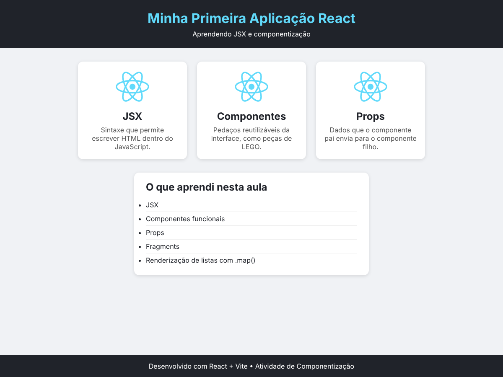

# Minha Primeira Aplicação React

Primeira aplicação React criada com **Vite**, aplicando os conceitos iniciais de **JSX** e **componentização**.



## Como executar

```bash
npm install
npm run dev
```

Depois, abra no navegador o endereço que aparecer no terminal (normalmente `http://localhost:5173`).

## Estrutura do projeto

```
src/
├── components/
│   ├── Card/
│   │   ├── Card.jsx
│   │   └── Card.css
│   ├── Footer/
│   │   ├── Footer.jsx
│   │   └── Footer.css
│   ├── Header/
│   │   ├── Header.jsx
│   │   └── Header.css
│   └── Lista/
│       ├── Lista.jsx
│       └── Lista.css
├── App.jsx
├── index.css
└── main.jsx
```

## O que foi feito

### Parte 1 – Exercício Guiado
- Projeto criado com `npm create vite@latest` usando o template **React**.
- Boilerplate removido (`App.css`, logos, contador de exemplo e estilos padrão).
- Criada a pasta `src/components` para organizar os componentes.

### Parte 2 – Mini Projeto (Componentes Base)
- **Header**: exibe o título da aplicação.
- **Footer**: exibe o texto de rodapé.
- **Card**: recebe `titulo`, `descricao` e `imagem` via **props** e é reutilizado três vezes.
- **App**: importa e renderiza os componentes dentro de um **Fragment** (`<> </>`), respeitando a regra do elemento raiz único.

### Parte 3 – Desafio
- **Lista**: recebe um array de strings pela prop `itens` e renderiza uma `<ul>` usando `.map()`, passando uma prop `key` única para cada `<li>`.

### Boas práticas aplicadas
- `className` no lugar de `class`.
- Nomes de componentes começando com letra maiúscula.
- Todas as tags fechadas, inclusive as vazias (``).

## Parte 4 – Reflexão

**Explique a diferença entre a abordagem imperativa (JavaScript puro/manipulação do DOM) e a declarativa (React). Por que o Virtual DOM otimiza a performance?**

Na **abordagem imperativa**, usada no JavaScript puro, o programador diz ao navegador *como* fazer cada passo: buscar o elemento (`document.querySelector`), criar novos elementos (`createElement`), alterar textos (`textContent`), adicionar ou remover classes e inserir tudo no lugar certo (`appendChild`). Toda vez que um dado muda, é preciso lembrar de atualizar manualmente cada parte da tela afetada. Em telas maiores isso gera código longo, repetitivo e fácil de quebrar, porque a tela e os dados podem ficar fora de sincronia.

Na **abordagem declarativa**, usada pelo React, o programador descreve *o que* a tela deve mostrar para um determinado estado dos dados. Por exemplo, em vez de criar cada `<li>` à mão, escrevemos `itens.map(item => <li>{item}</li>)` e o React se encarrega de gerar e atualizar o HTML. Quando os dados mudam, basta descrever a nova situação; o React descobre sozinho o que precisa ser alterado. O código fica mais curto, mais previsível e mais fácil de manter, além de poder ser dividido em componentes reutilizáveis.

O **Virtual DOM** é uma cópia leve da estrutura da página, mantida em memória pelo React como objetos JavaScript. Mexer no DOM real do navegador é uma operação cara, porque cada alteração pode fazer o navegador recalcular o layout e redesenhar a tela. Quando algo muda, o React primeiro cria uma nova versão do Virtual DOM e a **compara** com a versão anterior (processo chamado *diffing* ou *reconciliação*). Assim ele identifica exatamente quais partes mudaram e aplica no DOM real **apenas essas alterações mínimas**, muitas vezes agrupadas em uma única atualização. Isso evita reconstruir a página inteira e reduz o número de operações caras no navegador, o que melhora a performance. É também por isso que a prop `key` é importante nas listas: ela ajuda o React a saber qual item é qual durante essa comparação.

## Tecnologias
- [React](https://react.dev/)
- [Vite](https://vite.dev/)
